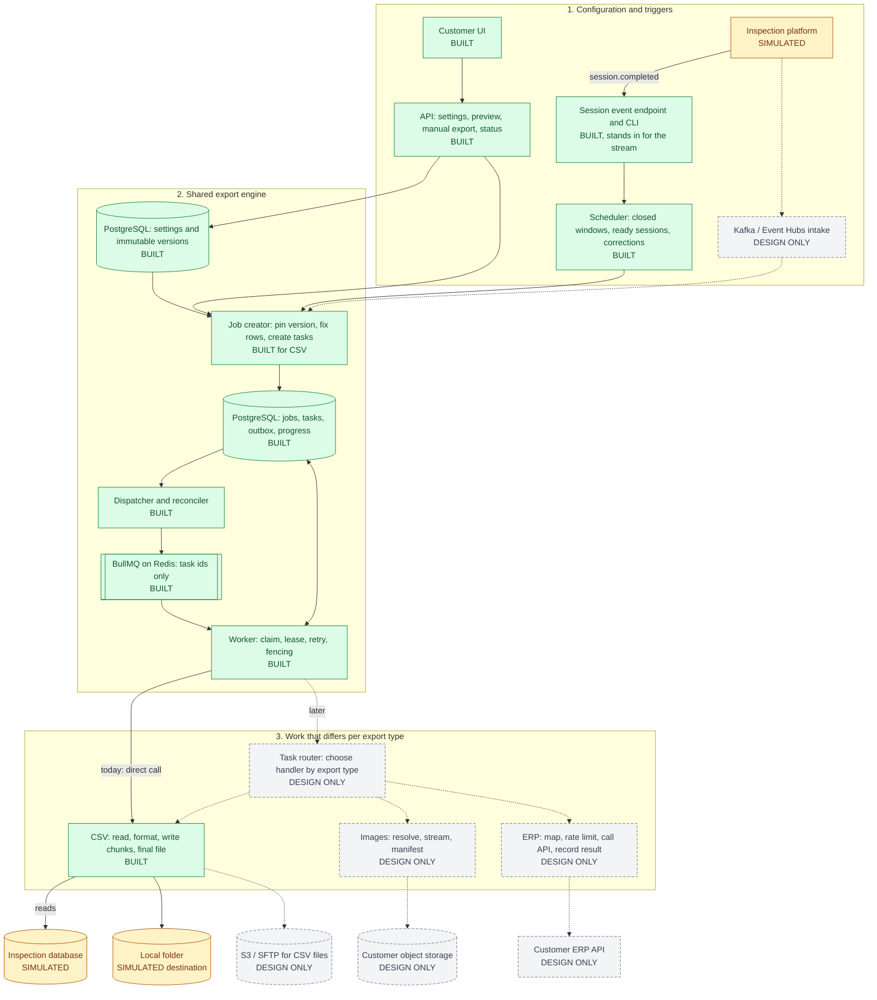
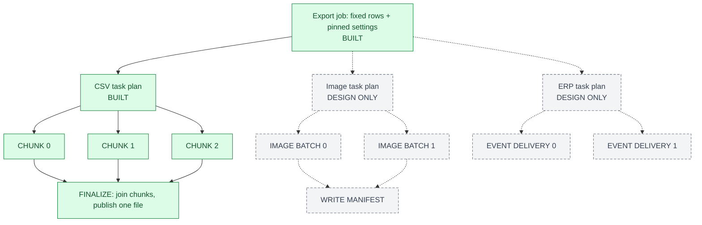
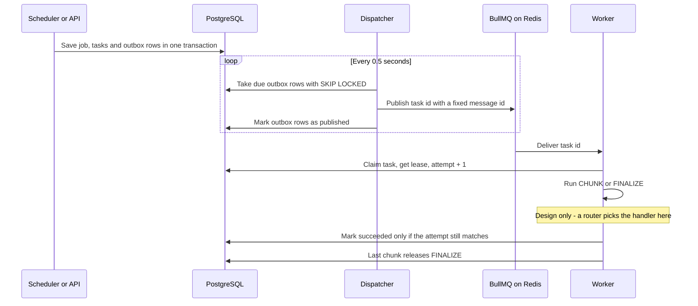
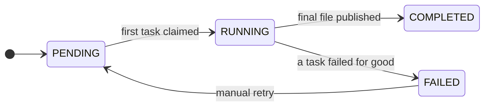
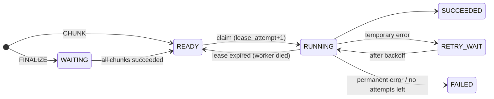
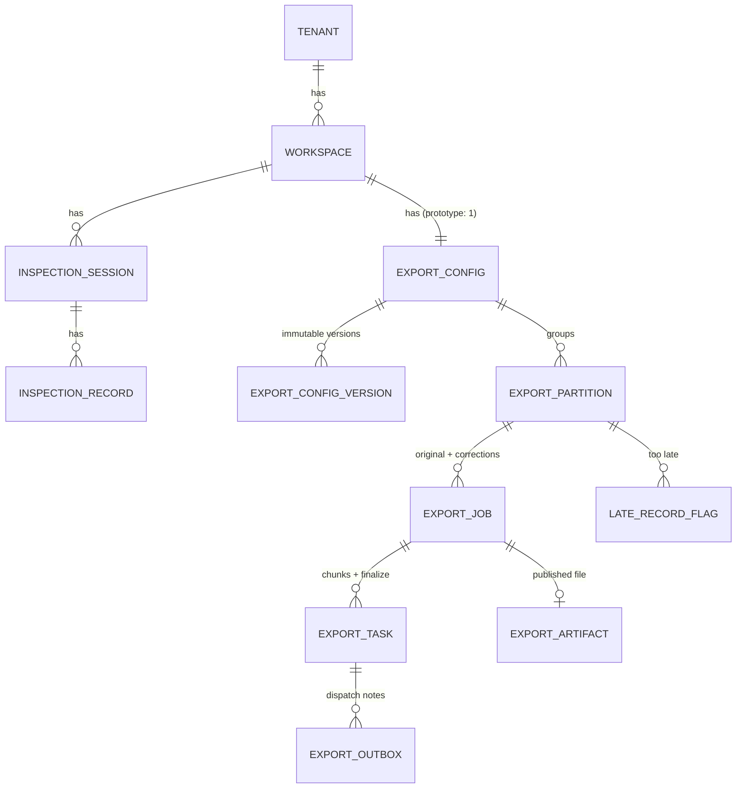

# Architecture

This page shows the **full platform design** and says clearly **which parts are built today**.
It uses simple words. For the "why" behind each choice, see [decisions.md](decisions.md).

The design covers all three scenarios: CSV reports, images to object storage, and events to an ERP.
The prototype builds **one complete path: CSV reports**, on a shared engine that the other two can reuse.

## Built and design-only at a glance

| Label | Meaning |
| --- | --- |
| **Built** | Real code in this repository, covered by tests |
| **Simulated** | Works in the demo, but stands in for a real outside system |
| **Design only** | Planned here. There is no code for it yet |

| Part of the platform | Status | Notes |
| --- | --- | --- |
| Customer settings, validation, immutable versions, live preview | **Built** | `modules/export-config` |
| Scheduler, session-based groups, late-record corrections, one-time exports | **Built** | `modules/scheduler`, `modules/events`, `modules/jobs` |
| Jobs, tasks, transactional outbox, dispatcher, reconciler | **Built** | `modules/jobs`, `modules/dispatch` |
| BullMQ queue behind a small interface | **Built** | `modules/queue` |
| Workers with leases, fencing, retries and backoff | **Built** | `modules/worker`, `modules/jobs/task-state.ts` |
| CSV export: chunks, then one final file | **Built** | `modules/worker`, `modules/csv` |
| Tenant isolation, per-workspace running-task cap, status API, UI | **Built** | `modules/tenancy`, `src/api`, `frontend/` |
| Inspection data, login, source events | **Simulated** | Seeded tables, `x-tenant-id` header, HTTP endpoint and CLI |
| CSV destination | **Simulated** | A local folder stands in for S3 or SFTP |
| Choosing a handler by export type (strategy layer and task router) | **Design only** | Today the worker calls the CSV code directly |
| Image export and ERP export | **Design only** | [other-scenarios.md](other-scenarios.md) |
| Destination adapters (S3, SFTP, customer API), secrets vault | **Design only** | |
| Event stream intake (Kafka / Event Hubs) | **Design only** | |
| Shadow run for breaking format changes | **Design only** | [format-evolution.md](format-evolution.md) |

## 1. The problem in one paragraph

Loopr customers inspect parts. Each inspection creates a **record** (result, defect, image link, time).
Records belong to a **session**, sessions belong to a **workspace**, workspaces belong to a **tenant** (customer).
Customers want these records outside Loopr: as CSV files, as images in their storage, or as messages to their ERP.
Every customer wants something a bit different, and there can be millions of records.
We need **one shared platform** that handles all of this through **settings**, not custom code per customer.

### Assumptions that shape the design

| Assumption | Why it matters | If it is wrong |
| --- | --- | --- |
| A record is **finalized** once (`finalized_at` is set) and never changes after that; each record has a stable id | Exports can be cut by `finalized_at` without missing or repeating records | Edits after finalization would need replacement files, not additive corrections |
| A finalized record becomes visible in the database within a few seconds (`CUTOFF_SAFETY_SECONDS`) | The cutoff trails "now" by that margin so no record lands behind it | Use a database commit sequence or change-data-capture instead of a time margin |
| The export platform may **read** the inspection database (a read replica in production) | Big exports read in pages without loading the main platform | Use a bulk export API of the inspection platform instead |
| Customers group reports by **inspection time** in their own timezone, and can load extra **correction files** | Late records are delivered without rewriting files already sent | Offer replacement files (a full new version of the hour) as an option |
| `session.completed` may arrive twice, late, or before every record is final | Events are de-duplicated, and a settle delay + corrections cover late records | — |
| One hour of one workspace is thousands of records; a backfill can be millions and run for hours | Chunked, parallel, resumable jobs; nothing waits in an HTTP request | — |
| Tenant identity comes from the platform's login (a verified token) | Every query is scoped by tenant; the prototype simulates this with a header | — |
| Destinations accept "write the whole file under a fixed name" (object storage, SFTP rename) | Atomic publish and safe retries (same name, same content) | Destinations without overwrite need a delivery log and de-duplication |

## 2. Big picture

This is the **target architecture**. Green solid boxes are built. Grey dashed boxes are design only.
Each box also says its status in words.



All backend processes use **one Docker image**. They only differ by their start command.
You can run many workers (and even many schedulers or dispatchers) at the same time.

### How one CSV export runs today (built)

Imagine Acme wants a CSV every hour with only failed inspections, and the columns `Part`, `Result`,
`Inspection Time` and `Operator`.

1. **The customer configures the export once.** The UI sends the settings to the API. The API checks them and saves
   a new, immutable version in PostgreSQL. This is the recipe, not the exported data.
2. **A trigger starts the export.** The scheduler sees that the hour has closed (plus the grace time). A finished
   session or a manual request from the API can start an export too.
3. **The job is frozen.** The job creator pins the settings version, fixes which records belong to the job, and
   splits them into chunks. The job, one task per chunk, one finalize task and the outbox rows are saved in
   **one transaction**. If the customer changes settings later, this job does not change.
4. **The dispatcher sends task ids to the queue.** Messages are tiny, such as "run task 123". PostgreSQL stays the
   source of truth.
5. **Workers write the chunks.** A worker claims a chunk task and reads its records page by page. The database query
   applies the filters. The CSV code renames columns, changes values, formats dates and writes a temporary chunk file.
6. **The last chunk unlocks finalize.** A worker joins the header and chunks in order, publishes the file with one
   atomic rename, and marks the job complete.
7. **Failures are recoverable.** If a worker crashes, its lease expires and the reconciler makes the task runnable
   again. Finished chunks are kept. The retry uses the same settings version and the same rows.

### What "shared platform" means

"Shared" does not mean CSV, images and ERP do the same work. They share the plumbing and differ in the work itself.

- **Shared (built):** tenant checks, settings versions, job tracking, outbox, queue, worker claims, leases, retries,
  recovery, progress and logs.
- **Different per export type:** what a task reads, how it changes the data, what counts as one task, and how the
  result is delivered.

| Export type | Status | One task is | Work specific to this type | Result |
| --- | --- | --- | --- | --- |
| CSV | **Built** | A chunk of records, then one finalize task | Filter, map, format, join chunks | One CSV file |
| Images | **Design only** | A batch of images, then a manifest | Find images, stream bytes, track each image | Images in customer storage + manifest |
| ERP | **Design only** | One event or a small batch | Map payload, respect the rate limit, call the ERP, record the result | Delivery status per event |

### Where a new export type plugs in

Today the worker has one fixed path. This line is the place where a router will go
(`backend/src/modules/worker/task-runner.ts`):

```ts
task.kind === 'CHUNK' ? await this.runChunk(task, job, spec) : await this.runFinalize(task, job, spec);
```

**Why the router is not built yet:** with one export type it would have nothing to choose between. Its real shape
depends on what the second type needs, so building it now would mean guessing and keeping unused code. The time went
into the parts every export type depends on: correct data, crash recovery and duplicate protection.

**What adding the second type would take:**

1. Add an `exportType` to the settings and the job. Neither has one today, because CSV is the only format.
2. Add a task router in the worker, and move the CSV code behind it without changing its behaviour.
3. Write the new handler and its task plan, for example image batches followed by a manifest.
4. Make "finalize waits for all chunks" a general rule: a task waits for the tasks it depends on.
5. Add what the type needs: per-item progress and a `PARTIAL` result for images; a rate limiter and an `UNCERTAIN`
   result for ERP. Add a destination adapter for each new target.
6. Reuse the failure tests from CSV: crash, duplicate message, lost message, retry.

The engine is reusable, but it will need these small, known changes. The settings, outbox, queue, lease and fencing
design stays the same.

## 3. Components

| Component | Status | What it does | What it does NOT do |
| --- | --- | --- | --- |
| **UI** (`frontend/`) | **Built** | Shows exports, chunk progress, attempts and errors; edits and previews settings; starts manual exports | Has no business logic; only calls the API |
| **API** (`src/api`) | **Built** | Saves settings, previews them, starts manual exports, shows status, serves files, accepts source events | Never does heavy export work |
| **Scheduler** (`modules/scheduler`) | **Built** | Decides *when* exports run: closes hourly windows, starts original and correction jobs, flags very late records | Does not read or write CSV data |
| **Job creation** (`modules/jobs`) | **Built** for CSV | Pins the settings version, fixes the rows, creates chunk and finalize tasks + outbox rows in one transaction | Does not run tasks |
| **Dispatcher** (`modules/dispatch`) | **Built** | Sends outbox rows to BullMQ. Its reconciler fixes expired leases and lost messages | Does not choose an export type or do export work |
| **Queue** (`modules/queue`) | **Built** | Carries tiny messages: "run task X" | Is NOT the source of truth |
| **Worker** (`modules/worker`) | **Built** | Claims a task, then runs the chunk or finalize step | Does not choose which records belong to a job (that is fixed at job creation) |
| **CSV formatting** (`modules/csv`) | **Built** | Turns a record into a CSV line using the settings | Does not touch the database or files |
| **PostgreSQL** | **Built** | Stores configs, versions, partitions, jobs, tasks, outbox, artifacts | — |
| **Storage** (`modules/storage`) | **Built** (local folder) | Staging chunks + final published files | Does not connect to S3 or SFTP yet |
| **Task router** | **Design only** | Will read the export type and call the matching handler | Will not do the export work itself |
| **Image and ERP handlers** | **Design only** | Will do the work specific to each type | Will not own jobs, queueing, leases or retries |
| **Destination adapters** | **Design only** | Will deliver to S3, SFTP or a customer API | — |

## 4. Main ideas

### 4.1 Settings, not code

A customer's export is a **spec** (JSON) with: columns, header names, value mapping, date format, timezone,
filters, grouping, correction window and destination. It is checked against an allow-list when saved.
Unknown fields, unknown timezones or unsupported combinations are rejected.
A new **combination** of existing options needs no code. A new **capability** (a new file format, a new destination)
is written once as reusable platform code and is then available to every customer.

### 4.1a When the core platform still has to change

Settings cover choices *between* things the platform can already do. Code changes are still needed when a
customer needs something new **for everyone's platform**, never a private branch for one customer:

| Request | Settings only? | Why |
| --- | --- | --- |
| Rename a column, change values, add a metadata field, filter, change date format, switch hourly ↔ per session | Yes | Combinations of existing options |
| A new file format (JSON lines, Parquet, XML) | No: a new **formatter** | New output code, then a new `format` value in the spec |
| A new destination (S3, SFTP, a customer's API) | No: a new **delivery adapter** | New network code, credentials handling, retry rules |
| A new kind of transformation (sum per hour, join with another table, number formatting) | No: a new **option type** | Must stay declarative and checked; we do not accept scripts |
| A new source field that is not in metadata | No: a schema / allow-list change | Fields are allow-listed for safety and indexing |
| A new trigger (e.g. "when a batch closes") | No: a new **close rule** | New event handler + tests for duplicates and gaps |
| Truly one-off logic for one customer | Avoid | Prefer a general option that others can use; otherwise a separate integration outside the core |

Each new capability is built once, gets its own tests, becomes a new allow-listed option, and is then
available to every customer. Old specs keep working because new options are added, never changed.

### 4.2 Immutable versions

Every edit creates a new config version. Old versions never change.
Every job remembers the version it uses. Retries use the same version, so they produce the same file.

### 4.3 Groups (partitions)

A **partition** is a group of records exported together. Two kinds are supported:

- **TIME**: one time bucket, e.g. 10:00–11:00 in Asia/Kolkata. Closes at bucket end + grace time.
- **SESSION**: one inspection session. Closes when a `session.completed` event arrives + a settle delay.

Each partition has a bookmark: `last_cutoff`. It says "every record finalized up to this time has been delivered".

### 4.4 Jobs and tasks

Only the CSV plan is built. The image and ERP plans show how the same job model extends.



- A **job** is one export (one file). Its rows are fixed when it is created.
- A job is split into **chunk tasks** of `chunkSize` rows. Chunk boundaries are fixed at creation.
- Chunks run **in parallel** on any worker and write **staged chunk files**.
- When the last chunk succeeds, the **finalize task** joins header + chunks into the final CSV and publishes it with one atomic rename.

### 4.5 Durable dispatch: outbox + queue

This flow is built. The note marks the one step that changes when a second export type arrives.



PostgreSQL and Redis cannot share one transaction. The **outbox** solves this: the "please send" note is saved
in the same transaction as the job. If the dispatcher crashes, it simply sends the note again later.
Duplicates are harmless because the worker's claim only succeeds once.

### 4.6 State machines

Both state machines are built.





## 5. One hourly report, step by step

This flow is built and tested.

1. 11:05 (hour 10:00–11:00 closed + 5 min grace). The scheduler creates partition `2026-11-11T10:00Z`.
2. It locks the partition and creates a job: rows = records with `inspected_at` in the hour and
   `finalized_at <= cutoff` (cutoff = now − small safety margin). It splits them into chunks.
   Job, tasks and outbox rows are saved in **one transaction**.
3. The dispatcher sends the chunk tasks to BullMQ. Three workers each take some chunks.
4. Each worker claims its task (lease 60 s), reads its rows page by page (bounded memory), writes a staged chunk.
5. The last chunk to finish releases the finalize task. A worker joins the chunks, publishes
   `report_2026-11-11T1000Z.csv` and, in one transaction, marks the job COMPLETED and moves
   the partition bookmark to the job's cutoff.
6. At 11:30 a late record for 10:20 arrives. The next scheduler tick sees a record with
   `finalized_at > last_cutoff` and creates `report_2026-11-11T1000Z_correction_01.csv` with only that row.

### 5a. The same report, with a failure

This recovery is built and tested.

In step 4, worker 2 crashes (its container is killed) halfway through chunk 3.

- Chunk 3 stays RUNNING with a lease until 11:06:40. Nothing else is lost: chunks 1 and 2 are done and saved.
- When the lease ends, the reconciler sets chunk 3 back to READY (attempt 1 used) and re-queues it.
- Worker 3 takes it as attempt 2 and writes the chunk again from the start. Chunks are written to a temp file and
  renamed when complete, so worker 2's half-written data never became a chunk file.
- If worker 2 was only frozen and wakes up later, its save is refused because its attempt number is old
  (**fencing**). So the chunk is counted once.
- Any other task running in the same dead process is recovered the same way.
- The export stays *In progress* the whole time; its details show chunk 3 with 2 attempts.
- Finalize runs only when every chunk has succeeded, so a half file is never published.

Watch this happen with one command: README → *Watch a crash and the recovery*.
Automated tests: `backend/tests/integration/recovery.test.ts`.

## 6. Data model

All tables below are built. Image and ERP would add their own tables, such as `export_item` for per-image progress.



The full schema with comments is in [`backend/src/db/migrations/`](../backend/src/db/migrations/).

An `inspection_record` has fixed fields (id, session, part serial, inspection type, result, defect, image link,
inspected/finalized time) plus **`metadata`**: a JSON bag of customer-specific extra fields (e.g. Acme sends
`line`, `operator`, `torque_nm`; Globex sends `station`, `batch`, `defect_area_mm2`). Customers export and
filter these through their settings (see [D-18](decisions.md)).

| Table | Purpose |
| --- | --- |
| `export_config` | One per workspace. Points to the current version. |
| `export_config_version` | The spec. Never updated after insert. |
| `export_partition` | One group (hour or session). Holds `last_cutoff`, `last_correction_no`, `in_flight_job_id`. |
| `export_job` | One export / one file. Fixed rows (range, session, cutoffs), pinned version, status. |
| `export_task` | Chunk or finalize. Status, attempt (fencing token), lease, retry time, error. |
| `export_outbox` | "Send task X to the queue" notes, written in the same transaction as the task change. |
| `export_artifact` | The published file: location, row count, SHA-256. |
| `late_record_flag` | Records that arrived after the correction window. Need a manual backfill. |
| `processed_event` | Source events already handled, so duplicates are ignored. |
| `field_layout` | A customer's own groups of fields on the settings screen. Display only. |

## 7. Scale

Everything here is built unless it says design only.

- **Reads** use keyset paging on `(inspected_at, id)` with an index. Memory stays small for any size.
- **Chunks** run in parallel across workers. Add workers with `docker compose up -d --scale worker=N`.
- **Queue messages** are tiny (a task id). No data passes through Redis.
- **Staging files** are deleted after publication.
- **Per-workspace cap**: a workspace runs about `WORKSPACE_MAX_RUNNING_TASKS` tasks at once, so one huge
  export cannot take every worker. This is a soft limit (see [§10](#10-main-risks)).
- Production (design only): read replica for heavy reads, separate worker pools and queues per export type,
  per-tenant fair scheduling, autoscaling on queue age.

## 8. Security

Everything here is built unless it says simulated or design only.

- **Tenant isolation**: the tenant comes from the caller identity (simulated by the `x-tenant-id` header;
  production: a verified token). Every query is scoped by tenant/workspace. Another tenant's workspace or
  export returns **404**, so we do not even reveal that it exists.
- **No customer code**: settings are data checked against an allow-list. No scripts, no templates.
- **CSV injection**: values starting with `=`, `+`, `-`, `@` get a leading `'` so spreadsheets do not run them.
  Negative numbers (`-12.5`) and a lone `-` are left as they are, so numeric data stays correct.
- **Safe file paths**: folder names are validated; downloads cannot leave the storage root.
- **Images**: the demo uses public sample pictures only. Real customer images must never be made public;
  production would use short-lived signed links.
- Design only: PostgreSQL row-level security, secrets in Azure Key Vault (settings hold only a reference),
  audit log of settings changes and downloads.

## 9. Operations

- Built: structured JSON logs (pino) with `jobId`, `taskId`, `workerId`, `attempt`.
- Built: the export detail endpoint shows chunk progress, attempts, errors and the file checksum.
- Design only: metrics and alerts on oldest waiting task, failure rate, groups late beyond grace,
  retry spikes and ERP throttling; runbooks for stuck jobs, failed jobs and "a record is missing".

## 10. Main risks

| Risk | What could happen | Today | Next step |
| --- | --- | --- | --- |
| A record becomes visible later than the 5-second safety margin | It could fall behind a cutoff and be missed | Assumption stated in §1 | Use a database commit sequence or change feed |
| A chunk or finalize task runs longer than its lease | The task is redone; after 3 attempts the job fails | Keep chunk size reasonable | Extend the lease with a heartbeat |
| One very large customer | It can slow others | Per-workspace cap of 4 running tasks. This is a **soft limit**: workers claiming at the same moment can briefly go over it, and no automated test covers it | Strict limit and per-tenant fair queues |
| Many tasks waiting behind the cap | Each waiting task retries every 2 seconds and adds an outbox row | Accepted for the prototype | Release waiting tasks only when a slot opens |
| Outbox rows are never deleted | The table keeps growing | Not handled | Scheduled cleanup of old published rows |
| Exports read the inspection database | Big exports can slow the main product | Small, indexed page reads | Read replica |
| Metadata filters have no index | Slow on very large selections | Fine within one hour or session | Index, or promote common fields to columns |
| A failed report blocks later corrections for that group | Late records wait until someone retries it | Visible in the UI and API, but no alert | Alerts |
| A customer ignores correction files | Their totals are incomplete | Documented behaviour | Optional full replacement file |
| Real destinations fail in ways a local folder does not | Partial uploads, expired credentials | Not tested | Build and test the adapters |

## 11. Cost

This section lists what drives cost. It gives no prices, because they depend on the cloud provider and data size.

| Cost driver | Grows with | How the design controls it |
| --- | --- | --- |
| Database reads | Rows exported, corrections | Indexed paging; each record is normally read once per file |
| Worker compute | Rows and columns | Workers are stateless, so they can scale down when idle |
| Temporary storage | Size of running exports | Chunk files are deleted after publishing |
| Delivered files | Customer's data and retention | Corrections contain only new rows, not a full copy |
| Redis | Number of tasks | Messages hold only a task id |
| Database history | Versions, jobs, tasks, outbox | **No cleanup yet**; production needs a retention policy |
| Network (design only) | Files or images sent outside | Mostly affects image export; send each item once and skip finished ones |

Retries and shadow runs add cost, because the same work runs again.

## 12. Behaviour under load

- **Extra work waits safely.** It stays in PostgreSQL and is not dropped.
- **Default capacity:** 3 workers × 4 tasks = 12 running tasks.
- **One workspace uses about 4 of those 12.** The rest stay free for others. The trade-off is that one big export
  stays limited to about 4 tasks even when the system is idle.
- **Worker memory stays small:** records are read 500 at a time.
- **Creating a large job scans every selected row once** to work out the chunk boundaries.

### One measured run

One export of generated records on a laptop, repeated 3 times. Docker had 8 CPUs and about 8 GB of memory.
Settings: 3 workers, chunk size 5,000, default cap of 4 running tasks.

| Measure | Result |
| --- | --- |
| Rows in the file | 100,048 (100,000 generated + 48 demo records) |
| File size | 9.8 MB |
| Parts | 21 chunks + 1 finalize, no retries |
| Time from job creation to finished file | 3.4 s, 3.6 s and 5.6 s |
| Speed | About 18,000–29,000 rows per second |
| Correctness | All 100,000 generated records appeared exactly once in every file |
| Highest worker memory seen | 91 MiB |

This is a small check, not a capacity test. There was no other customer running and no new data arriving, and the
records were small. It does not prove the speed for millions of rows. A production test should measure rows per
second per worker, the age of the oldest waiting task, and database load, with several customers running at once.
