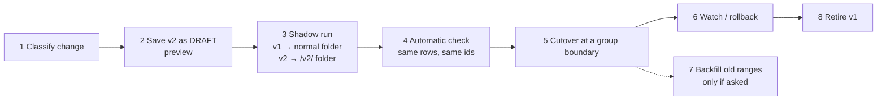

# Changing the file format after six months (design)

**Situation:** a customer has received hourly CSVs for six months. Their ERP import reads them every hour.
Now they want: result codes `PASS→1`, `FAIL→0`, dates as `DD-MM-YYYY`, and a new `operator` column.

We do not own their import code. Our job is to give them a **safe way to switch**.

## Assumptions

- The customer can test a sample file and agree an overlap period.
- We do not know how their import reads files, so any rename or reorder counts as breaking.
- Source records are kept long enough to regenerate old periods.
- Finalized records do not change, so old and new files can be compared.
- Files already delivered stay with the customer and are never changed.

## What is already in place

- Configs are versioned and never edited in place (D-09). A change is a new version.
- Every job is pinned to a version. Old groups and their corrections keep the old version.
- Exports are deterministic: the same group + the same version gives the same file again.
- A preview endpoint shows the new format on real data without delivering anything.

## Compatibility rules

| Change | Type | How we release it |
| --- | --- | --- |
| New column at the end | Usually safe | Preview, customer confirms, switch at a group boundary |
| Rename, remove or reorder a column | Breaking | Full process below |
| Change values or date format | Breaking | Full process below |
| Change grouping or file naming | Breaking | Full process below; the schedule switch is built |

The old version keeps working until the customer has confirmed the new one.

## The process

1. **Classify.** *Additive* (a new column at the end) is usually safe to switch directly.
   *Breaking* (rename, remove, reorder, value or date format change, grouping change) needs the full process.
   This example is breaking.
2. **Draft.** Save v2 with status `DRAFT`. The customer checks the preview.
3. **Shadow run.** For an agreed period (e.g. one week), v1 keeps going to the normal folder and v2 also runs,
   writing to a separate folder (`/v2/`). The customer points a test import at `/v2/`.
4. **Verify automatically.** For each group, compare v1 and v2 files: same row count and same set of record ids.
   Any mismatch blocks the cutover.
5. **Cutover** at an agreed group boundary (e.g. from 2026-06-01 00:00). Earlier groups and their corrections stay v1.
6. **Rollback** if their import breaks: make v1 active again from the next group. Because exports are deterministic,
   affected groups can be regenerated in v1.
7. **Backfill** only on request: a manual export of old ranges with v2 into a separate folder.
   Files already delivered in v1 are **never overwritten**.
8. **Retire v1** after the overlap period. Keep the version record for audit.

## Changing the schedule type (built)

A customer can switch between **hourly files** and **one file per session** in Settings, or change the
bucket size (e.g. every hour → every 6 hours). The change never starts "now", because a switch in the
middle of an hour or a session would leave gaps or send records twice. It starts at the **next clean boundary**,
saved as `effective_from` on the new version:

| Change | Starts at | What happens to the data around the switch |
| --- | --- | --- |
| Hourly → per session | End of the current hour | That hour is still sent as an hourly file. A session that crosses the switch gets a file with only its records from after the switch. |
| Per session → hourly | Start of the next hour | A session that crosses the switch gets a file with only its records from before the switch. Hourly files start at the switch. |
| Bucket size or timezone | First moment that is a boundary in both | Refused if the windows never line up (e.g. UTC hours vs Asia/Kolkata hours). |

Example: Acme is hourly and switches to per session at 10:20. The 10:00–11:00 file is sent as usual. A session from
10:50 to 11:30 gets a session file with its records from 11:00. Every record lands in exactly one file.

Rules:
- Only one planned change at a time. Another schedule change is possible after it starts.
- Files already sent never change. Late records of an old group still go out as corrections of that group.
- Code: `backend/src/modules/export-config/grouping-switch.ts`. Tests: `tests/integration/schedule-switch.test.ts`.

The shadow run described above is still the safer route for customers whose import cannot handle the change
on its own; the boundary switch is the self-service part.

## Additions needed (not built)

- `export_config_version.status`: `DRAFT | SHADOW | ACTIVE | RETIRED`
- `export_config.shadow_version_id`
- `export_job.mode`: `PRIMARY | SHADOW`
- Version folder or suffix in file names

## Trade-offs

- Double processing and storage during the overlap.
- Needs the customer's participation (test import, sign-off).
- A schema registry and formal contract tests are possible later steps.
