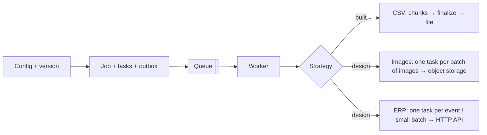

# Images and ERP: design (not coded)

The assignment asks to design all three scenarios and build one. CSV reports are built.
This page shows how the **same platform** handles the other two. Config versions, jobs, tasks, outbox, queue, workers,
leases, retries and status are reused. Each new type adds its own handler and destination adapter, plus a few small
engine changes, such as an export type on the job
(see [where a new export type plugs in](architecture.md#where-a-new-export-type-plugs-in)).



---

## A. Inspection images → customer object storage

**Need:** copy chosen images into the customer's bucket, grouped by session, with their own naming rule.

### Settings

```json
{
  "type": "images",
  "selection": { "results": ["FAIL"], "inspectionTypes": ["surface"] },
  "naming": "{session_id}/{part_serial}_{record_id}.jpg",
  "missingImagePolicy": "SKIP_AND_REPORT",
  "destination": { "type": "s3", "bucket": "acme-qc", "prefix": "loopr/", "credentialsRef": "vault://acme/s3" }
}
```

The naming template only allows known placeholders. Values are cleaned so they cannot create `../` paths.

### How it runs

1. Trigger: manual (a set of sessions) or scheduled / session-completed (reuse the grouping from D-13).
2. Job creation lists the selected records and splits them into tasks of, say, 200 images.
3. Each task: for each image, resolve its storage location (old and new layouts are hidden behind a resolver),
   stream it from Loopr storage to the customer bucket under a **deterministic key**.
4. Progress is stored per image (`export_item` table: record id, status, key, error), so a retry skips done images.
5. A manifest file (`manifest.json` with every image and its status) is written last.

### Failure cases

| Case | Handling |
| --- | --- |
| Image missing for good | Policy: `SKIP_AND_REPORT` → job ends **PARTIAL** with the skipped list in the manifest; or `FAIL` → job FAILED. Never reported as fully complete. |
| Image temporarily unavailable | Retry with backoff (TransientError). |
| Legacy storage layout | A location resolver knows both layouts. The customer's naming never shows internal paths. |
| Crash after 800 of 1000 uploads | Per-image progress; deterministic keys make a repeat upload an overwrite, not a duplicate. Optional checksum compare to skip. |
| Destination credentials wrong | Permanent error → FAILED with a clear message. |

New pieces: `ImageExportStrategy`, `SourceImageResolver`, `ObjectStorageDestination`, `export_item`, the PARTIAL job state.

---

## B. Inspection events → customer ERP API

**Need:** send inspection events to the customer's ERP, mapped to their field names, without breaking their rate limit.

### Settings

```json
{
  "type": "erp",
  "events": ["inspection.finalized"],
  "mapping": [
    { "from": "part_serial", "to": "MaterialNo" },
    { "from": "result", "to": "QualityStatus", "valueMap": { "PASS": "ACCEPTED", "FAIL": "REJECTED" } },
    { "static": "LOOPR", "to": "SourceSystem" }
  ],
  "endpoint": { "url": "https://erp.acme.test/api/quality", "authRef": "vault://acme/erp" },
  "rateLimit": { "requestsPerSecond": 5 },
  "ordering": "NONE"
}
```

Protected fields (tenant, workspace, event id, idempotency key) cannot be remapped or overwritten.

### How it runs

1. **Intake:** the inspection platform publishes events to a durable stream (Kafka / Azure Event Hubs).
   An intake consumer writes a delivery task per event (or small batch) with the outbox, using the event id
   as a unique key, so duplicate events are ignored.
2. **Delivery:** an ERP worker pool takes tasks, maps the payload, and sends it with header
   `Idempotency-Key: <event id>`. A **shared rate limiter per destination** (a token bucket in Redis) paces all workers.
3. The response is stored per event: delivered, failed, or **uncertain**.

### Failure cases

| Case | Handling |
| --- | --- |
| More events than the ERP allows | Backlog waits in PostgreSQL / queue; the rate limiter paces sending. Nothing is dropped. Alert on backlog age. |
| `429 Too Many Requests` | Respect `Retry-After`, slow the limiter down. |
| `503` / network error | Retry with backoff, bounded attempts. |
| `400` / `401` / `403` | Permanent: no blind retries; visible error, operator fixes mapping or credentials, then replays. |
| Timeout (did the ERP get it?) | Mark **UNCERTAIN**. If the ERP supports idempotency keys, retry safely. Otherwise look it up (if the ERP has a query API) before retrying. |
| Crash after the ERP accepted, before we saved it | Retry sends the same idempotency key → the ERP ignores the duplicate. Without ERP support we can only promise at-least-once. |
| Ordering needed per part | Optional per-key ordering: one in-flight event per part serial. Costs throughput. |

New pieces: event intake consumer, `ErpEventStrategy`, `HttpDestination`, per-destination rate limiter,
UNCERTAIN state and a reconciliation step.

### Delivery guarantee

At-least-once delivery with a stable idempotency key. **Effectively once only if the ERP honours the key.**
We do not claim exactly-once on our own.
